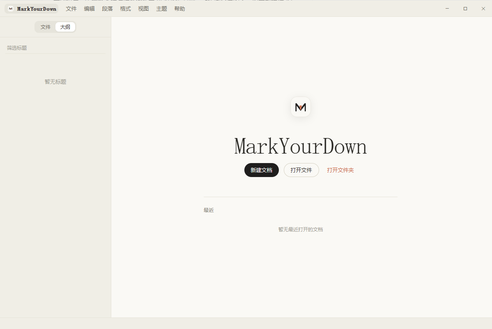

# MarkYourDown

MarkYourDown 是一款面向 Windows 的本地 Markdown 编辑器，基于 Wails、Go 和 Vue 构建。



## 功能

- 所见即所得编辑与源码模式切换
- 多文档标签、文件夹工作区、大纲、查找与替换
- 支持表格、任务列表、代码高亮、数学公式和 Mermaid 图表
- 支持插入本地图片、自动保存、草稿备份和 HTML 导出
- 支持打开本地 HTML 并转换为只读 Markdown 预览，另存为 Markdown 后可编辑
- 支持主题、正文宽度、专注模式和打字机模式

## HTML 导入说明

打开 `.html` 或 `.htm` 后，应用转换网页中的静态内容并显示只读预览；选择“另存为 Markdown”后可编辑保存的文件。原 HTML 不会被修改。常见标题、段落、列表、链接、图片和简单表格会转换；复杂表格、嵌入内容、网页布局和样式可能简化或无法保留，请查看转换说明并检查结果。转换不会执行网页脚本或抓取远程网页，动态生成的内容可能不存在。支持 UTF-8 和声明为 GBK/GB18030 的 HTML。

## 开发与构建

环境要求：Windows、Go 1.26+、Node.js 22.12+、npm、Wails v3 CLI 和 WebView2 Runtime。生成 Windows 安装程序还需要 NSIS。

在项目根目录运行：

```bash
# 启动开发模式
wails3 task dev

# 构建应用
wails3 task build

# 构建应用并生成安装程序
wails3 task package
```

构建结果位于 `bin/`：`markyourdown.exe` 为应用程序，`markyourdown-amd64-installer.exe` 为安装程序。

运行测试：

```bash
go test ./...
cd frontend
npm install
npm test
```

## 项目结构

```text
frontend/   Vue 前端、编辑器与导出功能
internal/   Go 后端、文件操作与系统服务
build/      构建配置和打包资源
tests/      测试与测试样本
```

## 常用快捷键

| 操作 | 快捷键 |
| --- | --- |
| 新建 / 打开 / 保存 | Ctrl+N / Ctrl+O / Ctrl+S |
| 打开文件夹 / 另存为 | Ctrl+Shift+O / Ctrl+Shift+S |
| 切换源码模式 | Ctrl+/ |
| 查找 / 替换 | Ctrl+F / Ctrl+H |
| 导出 HTML | Ctrl+Shift+E |
| 专注模式 / 打字机模式 | F8 / F9 |
