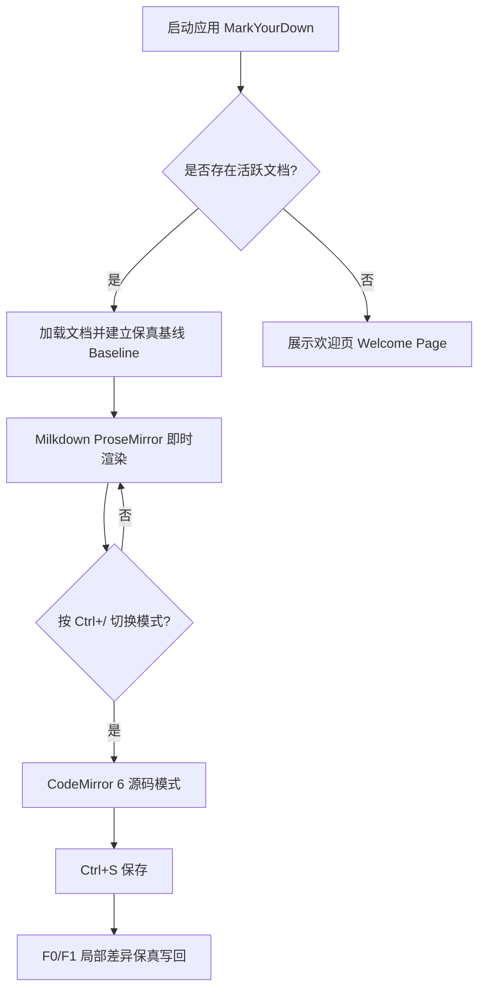
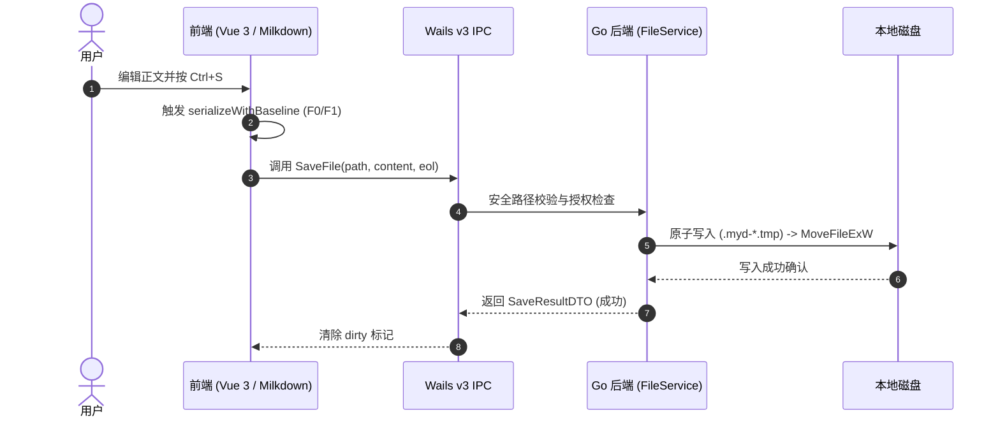

[TOC]

# 1. 标题语法验收 (Headings)

## 1.1 ATX 标题测试 (H1 到 H6)

# 一级标题 H1 (Title with 中文字符 & Special Characters: $ & #)
## 二级标题 H2 with trailing closing hashes ##
### 三级标题 H3 without closing hashes
#### 四级标题 H4 with `Inline Code` in title
##### 五级标题 H5 with **Bold** and *Italic*
###### 六级标题 H6 最小层级标题测试

## 1.2 Setext 标题测试

Setext 一级标题 (Equal Signs)
=============================

Setext 二级标题 (Dashes)
-----------------------

---

# 2. 段落、换行与空白 (Paragraphs, Line Breaks & Whitespace)

这是标准段落第一行。这里测试普通的连续文本流，包含中文标点符号：逗号，句号。感叹号！问号？冒号：分号；引号“双引号”和‘单引号’，《书名号》以及【方括号】。

这是同一段落内的软换行测试：
这一行应当按 CommonMark 规范被解析为包含空格的同段内容（在常规排版中中英文交界处应有合理排版间距）。

这是硬换行测试（行末有两个空格）：  
这一行必须强制另起一行，但依然属于同一个逻辑块。

这是使用反斜杠的硬换行测试：\
这一行同样必须强制另起一行。

这里是一个超长单行边界测试（超过 1000 字符无断行）：
Lorem ipsum dolor sit amet, consectetur adipiscing elit. Sed do eiusmod tempor incididunt ut labore et dolore magna aliqua. Ut enim ad minim veniam, quis nostrud exercitation ullamco laboris nisi ut aliquip ex ea commodo consequat. Duis aute irure dolor in reprehenderit in voluptate velit esse cillum dolore eu fugiat nulla pariatur. Excepteur sint occaecat cupidatat non proident, sunt in culpa qui officia deserunt mollit anim id est laborum. 这是一个超长的中文段落测试行，用于验证编辑器在大文本宽度下不发生卡顿、错位或意外折行问题。MarkYourDown 必须在各种分辨率与 DPI 下（100%, 125%, 150%, 200%）维持流畅的双向文本渲染与编辑性能，并且在源码模式与即时渲染模式之间平滑切换。测试文本继续延伸：0123456789 ABCDEFGHIJKLMNOPQRSTUVWXYZ abcdefghijklmnopqrstuvwxyz !@#$%^&*()_+~|}{[]:;?><,./-= 结束。

---

# 3. 强调与行内样式 (Inline Formatting)

- 星号单斜体：*这是斜体文字 Italic*
- 下划线单斜体：_这也是斜体文字 Italic_
- 星号双粗体：**这是粗体文字 Bold**
- 下划线双粗体：__这也是粗体文字 Bold__
- 粗斜体混合：***这是粗斜体 Bold Italic*** 以及 ___下划线粗斜体___
- 复合嵌套：**粗体中包含 *斜体* 和 `行内代码`**
- 删除线：~~这是被删除的文字 Strikethrough~~
- 高亮标记：==这是被高亮标记的重点文字 Highlight==
- 下标测试：化学方程式 H~2~O，CO~2~
- 上标测试：数学幂次 x^2^，公式 a^2^ + b^2^ = c^2^
- 混合 emoji 短码：:smile: :rocket: :tada: :warning: :white_check_mark: :heart: :sparkles:
- 直接 Unicode Emoji：😊 🚀 🎉 ⚠️ ✅ ❤️ ✨ 💻 📝

---

# 4. 代码语法 (Code Blocks & Inline Code)

## 4.1 行内代码

- 普通单反引号：`const x = 42;`
- 双反引号转义单反引号：``code with `backtick` inside``
- 三反引号转义双反引号：```code with ``double backticks`` inside```
- 带首尾空格的行内代码：`` `foo` ``

## 4.2 围栏代码块 (Fenced Code Blocks)

```typescript
// TypeScript 代码块高亮与缩进测试
export interface DocumentItem {
  id: string;
  title: string;
  path: string;
  isDirty: boolean;
  content: string;
}

export function formatTitle(item: DocumentItem): string {
  if (item.isDirty) {
    return `${item.title} *`;
  }
  return item.title;
}
```

```python
# Python 代码块
def calculate_fibonacci(n: int) -> list[int]:
    """生成斐波那契数列前 n 项"""
    if n <= 0:
        return []
    fib = [0, 1]
    while len(fib) < n:
        fib.append(fib[-1] + fib[-2])
    return fib[:n]

if __name__ == "__main__":
    print(calculate_fibonacci(10))
```

```bash
# Bash / Shell 命令行测试
#!/usr/bin/env bash
set -euo pipefail

APP_NAME="MarkYourDown"
echo "Building ${APP_NAME}..."
go test ./...
wails3 build
```

```json
{
  "name": "mark-your-down",
  "version": "1.0.0",
  "private": true,
  "config": {
    "theme": "warm-paper",
    "fontSize": 16,
    "lineHeight": 1.6
  }
}
```

~~~yaml
# 波浪号围栏代码块 (Tilde fenced)
app:
  name: MarkYourDown
  environment: production
  ports:
    - 8080
    - 8443
~~~

## 4.3 四反引号嵌套代码块边界

````markdown
这里是四反引号代码块，内部嵌套三反引号代码块：
```javascript
function greet() {
  console.log("Hello from inside nested markdown code fence!");
}
```
````

## 4.4 缩进式代码块 (Indented Code Block)

    // 缩进式代码块（4个空格缩进）
    int a = 10;
    int b = 20;
    int sum = a + b;
    printf("Sum: %d\n", sum);

---

# 5. 引用块与警示块 (Blockquotes & Callouts)

## 5.1 基础引用

> 这是一个单层引用块。
> 包含多行文字，引用内可以拥有段落。
>
> 引用块内的第二个段落。

## 5.2 嵌套引用与复合内容

> 第一层引用
> > 第二层嵌套引用
> > > 第三层深度嵌套引用
> >
> > 嵌套引用内包含无序列表：
> > - 列表项 A
> > - 列表项 B
> >
> > 嵌套引用内包含代码块：
> > ```go
> > package main
> > func main() { println("Quote in code") }
> > ```

## 5.3 GitHub 风格警示块 (Callouts / Alerts)

> [!NOTE]
> 这是注意提示块（Note），用于阐述背景信息、补充说明或默认配置行为。

> [!TIP]
> 这是操作技巧提示块（Tip），用于推荐性能优化建议、快捷键技巧或最佳实践。

> [!IMPORTANT]
> 这是重要信息提示块（Important），用于告知用户关键前提条件或核心使用要求。

> [!WARNING]
> 这是警告提示块（Warning），用于提示潜在破坏性变更、兼容性风险或网络状态提醒。

> [!CAUTION]
> 这是危险与小心提示块（Caution），用于警示高风险危险动作、数据可能丢失或不可逆操作。

---

# 6. 列表语法 (Lists)

## 6.1 无序列表与不同标记符

- 减号列表项 1
- 减号列表项 2
  - 子列表项 2.1
  - 子列表项 2.2

* 星号列表项 A
* 星号列表项 B
  * 子列表项 B.1

+ 加号列表项 X
+ 加号列表项 Y
  + 子列表项 Y.1

## 6.2 有序列表与不同起始编号

1. 有序项第一项
2. 有序项第二项
3. 有序项第三项

5. 自定义起始编号为 5 的列表项
6. 接着是 6
7. 接着是 7

1) 括号形式的有序列表
2) 括号形式第二项

## 6.3 5层嵌套深度列表极限边界测试

- 第一层列表 (Level 1)
  1. 第二层有序列表 (Level 2)
     - 第三层无序列表 (Level 3)
       1. 第四层有序列表 (Level 4)
          - 第五层最终深度列表项 (Level 5 Deepest Nesting)
          - 第五层兄弟项
       2. 第四层第二项
     - 第三层第二项
  2. 第二层有序第二项
- 第一层列表第二项

## 6.4 任务列表 (Task Lists / GFM To-Do)

- [ ] 未完成的任务项 1 (Pending task item)
- [x] 已完成的任务项 2 (Completed task item with checked box)
- [ ] 嵌套任务列表测试
  - [x] 子任务已完成
  - [ ] 子任务未完成
    - [x] 三级嵌套已完成任务
    - [ ] 三级嵌套未完成任务
- [ ] 包含行内样式的任务：**加粗任务**，*斜体*，`代码任务`，[链接任务](https://example.com)

---

# 7. 表格语法 (GFM Tables)

## 7.1 标准对齐表格

| 左对齐 (Left) | 居中对齐 (Center) | 右对齐 (Right) | 默认对齐 (Default) |
| :--- | :---: | ---: | --- |
| 文本数据 1 | 居中内容 A | 100.00 | 默认排版 |
| 较长的中文单元格内容 | 居中 B | 2,500.50 | 单元格 4 |
| 带有 `inline code` | **粗体数据** | 0.05 | *斜体数据* |

## 7.2 特殊转义与管道符表格

| ID | 特殊字符与代码 | 转义管道符测试 \| 依然在单元格内 | 状态 |
| :-- | :-- | :-- | :-- |
| 01 | `int[] arr = {1, 2};` | 正确使用 `\|` 转义管道符 | 正常 |
| 02 | `a < b && c > d` | 包含 HTML 实体与尖括号 | 正常 |
| 03 | [单元格链接](https://example.com) | ~~删除线文本~~ | 完成 |

---

# 8. 链接与图片 (Links & Images)

## 8.1 链接测试

- 行内链接：[MarkYourDown 官方指南](https://example.com/guide "指南说明文档")
- 无 Title 行内链接：[GitHub 仓库](https://github.com)
- 相对路径 Markdown 文档跳转：[查看贡献说明](./CONTRIBUTING.md)
- 锚点链接跳转：[跳转到第1节标题](#1-标题语法验收-headings)
- 自动链接 (Autolinks)：<https://v3.wails.io> 以及邮箱 <test@markyourdown.com>
- GFM 裸链接：https://google.com
- 引用式链接：[参考链接 A][ref-a] 以及 [参考链接 B][ref-b]

[ref-a]: https://commonmark.org "CommonMark Specification"
[ref-b]: https://github.github.com/gfm/ "GitHub Flavored Markdown Spec"

## 8.2 图片测试

- 远程网络图片：
- 本地相对图片：
- 带空格与特殊字符路径图片：
- 引用式图片：![CommonMark 引用图片][img-ref]
- 1x1 像素 Base64 Data URI 图片：
- 故意失效图片（验证 Alt 降级）：

[img-ref]: ./assets/logo.png "Ref Logo"

---

# 9. 脚注 (Footnotes)

这是一个测试脚注的第一句话[^1]。这里还有另外一个具名脚注[^note-chinese]。
这是同一句话中复用第一个脚注引用[^1]。

[^1]: 这是第一个脚注的完整说明文本，包含 [链接](https://example.com) 与 **强调** 格式。
[^note-chinese]: 这是支持中文标识符的具名脚注测试内容，支持多行缩进说明。
    缩进的第二行内容属于该脚注的一部分。

---

# 10. 数学公式 (KaTeX Math)

## 10.1 行内公式 (Inline Math)

爱因斯坦质能守恒方程为 $E = mc^2$。高斯求和公式为 $\sum_{i=1}^{n} i = \frac{n(n+1)}{2}$。
欧拉恒等式是数学中最优美的公式之一：$e^{i\pi} + 1 = 0$。

## 10.2 块级公式 (Block Math)

$$
\int_{-\infty}^{\infty} e^{-x^2} dx = \sqrt{\pi}
$$

$$
\mathbf{X} = \begin{pmatrix}
x_{11} & x_{12} & \cdots & x_{1n} \\
x_{21} & x_{22} & \cdots & x_{2n} \\
\vdots & \vdots & \ddots & \vdots \\
x_{m1} & x_{m2} & \cdots & x_{mn}
\end{pmatrix}
$$

---

# 11. Mermaid 图表 (Mermaid Diagrams)





---

# 12. HTML 标签兼容与净化 (HTML Elements & Sanitization)

MarkYourDown 必须正确解析安全子集内联与块级 HTML，同时经过严格 DOMPurify 净化：

<details>
  <summary>点击展开详情说明 (HTML details / summary 测试)</summary>
  这里是折叠在 details 标签内部的详细内容。支持<strong>加粗</strong>和<code>代码</code>。
</details>

- 键盘按键标签：请按 <kbd>Ctrl</kbd> + <kbd>Shift</kbd> + <kbd>P</kbd> 打开命令面板。
- 标记高亮：<mark>原生 HTML mark 高亮标签</mark>
- 上标与下标：CO<sub>2</sub> 以及 E = mc<sup>2</sup>
- 下划线：<u>带有下划线的文本</u>

---

# 13. 转义字符与 HTML 实体 (Escaped Characters & Entities)

- 字符转义：\*非斜体星号\*，\[非链接方括号\]，\`非代码反引号\`，\# 非标题井号
- 实体解码：&copy; 版权所有 (Copyright)，&amp; 符号 (&)，&lt; 小于号 (<)，&gt; 大于号 (>)，&quot; 双引号 (")

---

# 14. 分隔线变化形式 (Thematic Breaks / Horizontal Rules)

三连减号：
---

三连星号：
***

三连下划线：
___

带有空格的分隔线：
- - - -
* * * *

---

# 15. 文末空行与空白保真测试 (Tail Whitespace Fidelity)

本节用于验证在文档末尾存在特定空行与空格时，F0 保真算法不会误截断或擅自追加尾部换行。
当前行之后包含两个空行与尾随空白字符。


